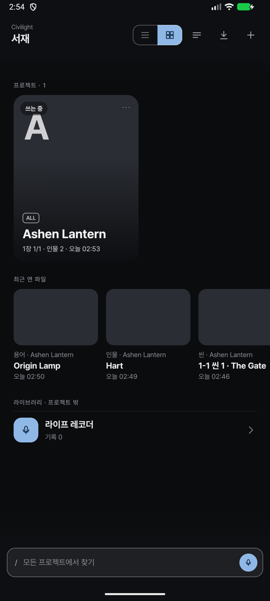
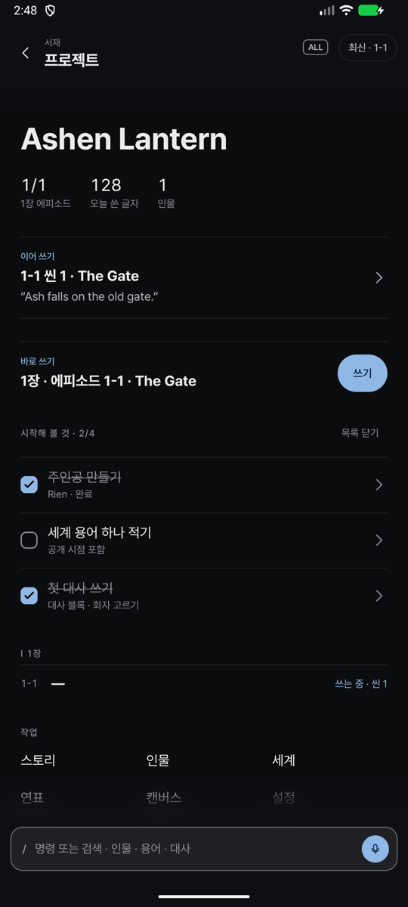
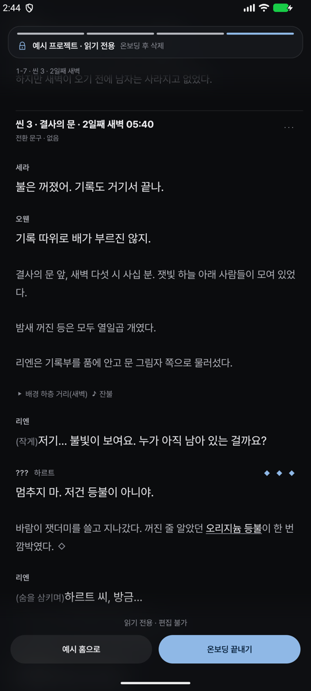
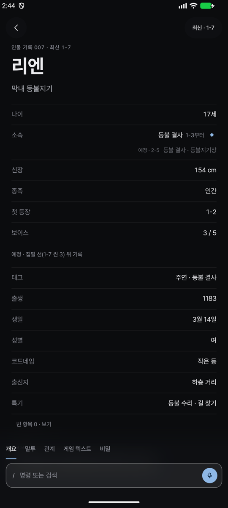
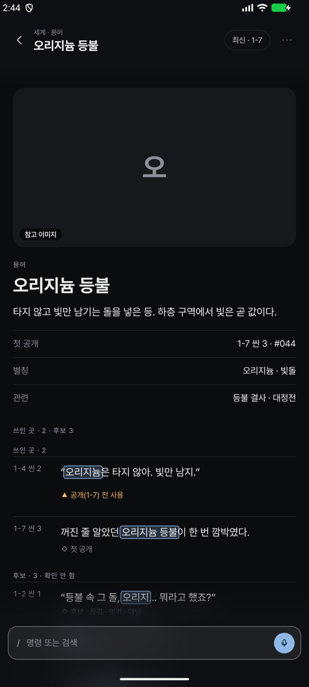
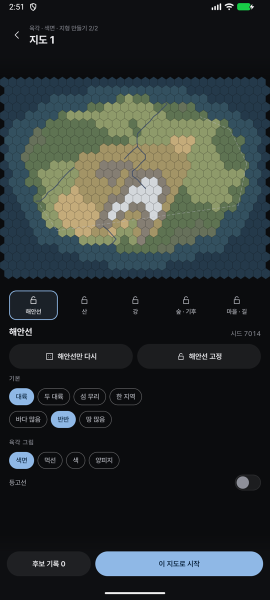
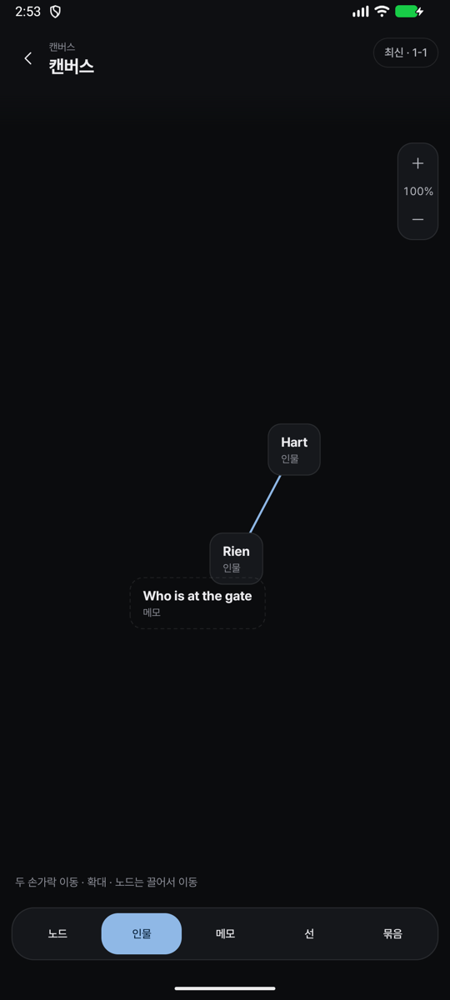
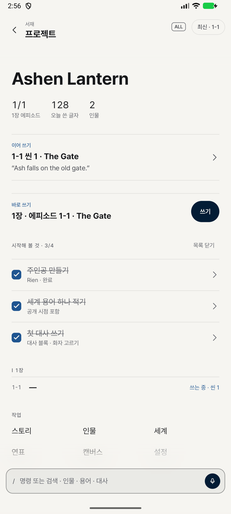

<div align="center">

<picture>
  <source media="(prefers-color-scheme: dark)" srcset="docs/assets/icon-dark.svg">
  
</picture>

# Civilight

방대한 세계관과 인물 관계를 다루는 창작자를 위한 로컬 우선 시나리오 집필 앱입니다.  
**갤럭시 Z 폴드 8**의 커버(10:16)와 내부 화면(4:3 세로·가로)을 기준으로 설계했습니다.


-blue)


</div>

## 소개

Civilight는 **원고(스크립트) · 인물 · 세계 · 연표 · 지도 · 캔버스 · 갤러리 · 라이프 레코더**를 하나의 프로젝트 안에서 연결해 쓰는 안드로이드 앱입니다.

* **시점 기반 설정 관리**: 현재 집필 중인 씬을 기준으로 인물 정보·관계·용어 공개 여부를 계산해, 아직 다루지 않은 설정이 원고에 먼저 섞이지 않도록 도와줍니다.
* **폴더블 중심 화면 구성**: 커버 화면에서는 빠르게 대사를 입력할 수 있고, 내부 화면에서는 원고와 보조 패널(시간·참고·속성·현황) 또는 목록과 상세를 나란히 두고 작업할 수 있습니다.
* **로컬 우선 저장**: 프로젝트는 기기 안에 JSON과 원본 이미지(블롭) 단위로 저장되며, `.civilight` 암호화 파일로 내보내거나 다시 열 수 있습니다.

## 주요 기능

### 스크립트 (원고)
* 대사 · 나레이션 · 괄호 지문 · 연출 지시 · 선택지 · 시스템 텍스트 · 작가 메모(`⌁`) 블록 지원
* 채팅형 하단 입력바 (화자 자동 이어쓰기, 종류 칩, 6줄 입력, `/` 단축 명령, `@` 항목 잇기)
* 블록 좌우 밀기 액션, 길게 누르기 통합 메뉴, 복선(`심기 · 다시 언급 · 거두기`), 에피소드 판 남기기
* 씬 단위 위치 표기(`1-7 씬 3`), 씬 나누기 · 합치기 · 옮기기, 대본 PDF / 대사 표 CSV / 게임 엔진 JSON 내보내기

### 스토리 · 시점 · 때 · 점검
* 프로젝트 홈, 이어 쓰기, 사용자 정의 이야기 단계 (장 · 에피소드 · 씬)
* **시점 렌즈**: 선택한 시점의 값으로 인물·세계 정보 조회, `이 값 고치기` / `여기서부터 바뀜` 분기 기록
* **때와 점검 센터**: 직전 씬 기준 간격으로 시간 계산, 앞질러 쓴 용어 · 지워진 항목 참조 · 이동 시간 점검

### 인물 · 갤러리
* 인물 목록 (3D 카드 보기 · 목록 보기), 다중 태그 필터, 프로젝트별 사용자 정의 항목, 말투 요약 및 비밀 탭 잠금
* 양방향 관계 및 시점별 변화 기록, 전체 관계도
* 인물별·프로젝트 통합 갤러리 (목록 · 격자 · 카드 · 필름 · 무드보드 · 빨랫줄 · 전시실 · 색 묶음 · 태그 줄 · 씬 순서)

### 세계 · 연표 · 지도
* 용어 (별칭 · 첫 공개 · 후보 탐색), 장소, 세력 카드
* 사용자 정의 세계 달력과 연표 (그때 나이 자동 계산)
* 지도 만들기 (지형 생성 · 이미지 가져오기 · 스케치 촬영 · 노드 지도), 핀 · 영역 · 경로 · 축척 · 인물 동선

### 서재 · 캔버스 · 페이지 · 보호
* **Atelier 서재 보기 6종** (기계식 1칸 락 저항감 설정 · 실시간 미리 보기 선택기 지원)
  * 오브젝트 · 3D: `CD 케이스` (3D 주얼 케이스 · 힌지 개폐 · 홀로그램 CD)
  * 모션 · 작업: `탄성 덱` (기계식 힌지 텐션) · `모자이크` · `필름 릴` · `시간 축` · `스튜디오 목록`
* **폴더블 커스텀 미니 아이콘 레일** (펼친 화면 패널 접힘 시 실시간 미리 보기와 함께 원하는 아이콘 커스텀)
* **스크립트 6종 블록 좌측 세이프 영역** (대사 1:1 사각형/원형 캐릭터 프로필 + 이름, 프로필 탭 시 캐릭터 카드 즉시 열람)
* **예상 플레이 타임 추론** (블록·연출·선택지 가중치 + 오차범위 표기) 및 **지도 마스터 시드 · 규모 설정**
* 다중 캔버스 (노드 · 메모 · 묶음 · 관계 선 잇기) 및 자유 문서 페이지
* 앱 잠금 · 프로젝트/항목 숨기기 (지문 · 기기 PIN), 화면 캡처 차단, 최근 앱 이름 가림, 휴지통 (30일 보관)

## 화면

<!-- SCREENSHOTS -->
<table>
<tr><td align="center"><br><sub>서재</sub></td><td align="center"><br><sub>프로젝트 홈</sub></td><td align="center"><br><sub>스크립트</sub></td><td align="center"><br><sub>인물 프로필</sub></td></tr>
<tr><td align="center"><br><sub>세계 · 용어</sub></td><td align="center"><br><sub>지도</sub></td><td align="center"><br><sub>캔버스</sub></td><td align="center"><br><sub>라이트 테마</sub></td></tr>
</table>

## 설치 방법

Android 10 (API 29) 이상 기기에서 설치할 수 있습니다.

1. [Releases](../../releases) 페이지에서 최신 `civilight-*.apk` 파일을 내려받을 수 있습니다.
2. 안드로이드 설정에서 해당 출처의 앱 설치 허용이 필요합니다.
3. 내려받은 APK 파일을 열어 설치를 진행할 수 있습니다.

## 빌드 방법

JDK 21 환경이 필요하며, `local.properties` 파일의 `sdk.dir`에 Android SDK 경로를 두어 빌드합니다.

```bash
./gradlew :app:assembleDebug
./gradlew :app:assembleRelease
./gradlew test
```

릴리즈 서명 설정은 저장소 밖 `~/.civilight-signing/signing.properties` (또는 `CIVILIGHT_SIGNING` 환경 변수)에서 읽어 사용합니다.

| 항목 | 값 |
| --- | --- |
| versionName | `0.4.1(Antigravity)` |
| minSdk / targetSdk / compileSdk | 29 / 37 / 37 |
| Kotlin / AGP | 2.4.21 / 9.4.1 |
| Compose BOM / Navigation3 | 2026.05.01 / 1.1.2 |

## 아키텍처 (23개 Gradle 모듈)

| 계층 | 모듈 | 역할 |
| --- | --- | --- |
| `core` | `model` `store` `designsystem` `navigation` `ui` | 불변 도메인 모델, 차분 저장소, 디자인 시스템, 라우팅, 공용 화면 프레임 |
| `domain` | `story` `script` `cast` `world` `trash` `library` `recorder` `checks` `actions` | 순수 JVM 비즈니스 규칙 및 계산 (단위 테스트 3,500+개) |
| `feature` | `library` `story` `script` `cast` `world` `map` `canvas` `recorder` | 영역별 Compose UI 및 상태 관리 |
| `app` | `app` | 앱 진입점, DI(`ServiceLocator`), Navigation3 조립, 생체 인증·힌지 연동 |

## 현재 한계 (외부 연동 스텁)

로컬 집필과 관리 기능은 모두 기기 안에서 동작합니다. 외부 서비스가 필요한 일부 기능은 스텁 또는 온디바이스 폴백으로 구성되어 있습니다.

* Google Drive 자동 백업 및 복원 (로컬 `.civilight` 내보내기·열기 지원)
* 실시간 음성 받아쓰기(STT) (녹음 및 원본 음성 보관·재생·수동 편집 지원)
* 클라우드 LLM 기반 지형 생성 (온디바이스 키워드 조건 해석기 지원)

## 글꼴 및 라이선스

* 글꼴: [Pretendard](https://github.com/orioncactus/pretendard) (SIL Open Font License 1.1 — [licenses/Pretendard-OFL.txt](licenses/Pretendard-OFL.txt))
* 앱 코드: 개인 프로젝트 (라이선스 미정)
